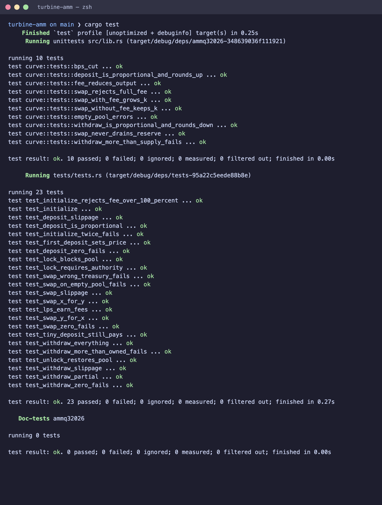

# turbine-amm

A constant product AMM (x · y = k) on Solana, written with Anchor and tested with LiteSVM.

Anyone can create a pool for a pair of SPL tokens, provide liquidity for LP tokens, swap between the two tokens, and burn LP tokens to get their share of the reserves back. Every swap pays an LP fee that stays in the pool and a protocol fee that goes to a treasury. The pool's authority can lock and unlock the pool.

The curve math is written from scratch in [`curve.rs`](programs/ammq32026/src/curve.rs). The program doesn't depend on the `constant-product-curve` crate.



## Layout

```
programs/ammq32026/
├── src/
│   ├── lib.rs               program entrypoints
│   ├── state.rs             Config account
│   ├── curve.rs             constant product math + unit tests
│   ├── constants.rs         PDA seeds
│   ├── error.rs
│   └── instructions/
│       ├── initialize.rs
│       ├── deposit.rs
│       ├── withdraw.rs
│       ├── swap.rs
│       └── update.rs        lock / unlock
└── tests/
    ├── tests.rs             LiteSVM integration tests
    └── ix_handlers/         instruction builders used by the tests
```

## Accounts

| Account | Seeds / derivation | What it is |
|---|---|---|
| `config` | `["config", seed]` | Pool state. Also the authority over the vaults and the LP mint. |
| `mint_lp` | `["lp", config]` | LP token, 6 decimals, minted and burned by `config`. |
| `vault_x`, `vault_y` | ATA(config, mint) | Pool reserves. |
| `treasury_x`, `treasury_y` | ATA(treasury, mint) | Where protocol fees go. |

```rust
pub struct Config {
    pub seed: u64,
    pub authority: Option<Pubkey>, // can lock / unlock, None = immutable pool
    pub mint_x: Pubkey,
    pub mint_y: Pubkey,
    pub treasury: Pubkey,          // wallet that owns the treasury token accounts
    pub fee: u16,                  // LP fee in bps, stays in the vaults
    pub protocol_fee: u16,         // protocol fee in bps, sent to the treasury
    pub locked: bool,
    pub config_bump: u8,
    pub lp_bump: u8,
}
```

## Instructions

### `initialize(seed, fee, protocol_fee, authority)`
Creates the config, LP mint, both vaults, and the treasury's token accounts for X and Y (`init_if_needed`, so one treasury can serve many pools). Fails with `FeePercentErr` if `fee + protocol_fee` is 100% or more.

### `deposit(amount, max_x, max_y)`
Mints `amount` LP tokens to the user.
- Into an empty pool: the user deposits exactly `max_x` and `max_y`, which sets the starting price.
- Otherwise the user pays `reserve * amount / lp_supply` of each side, **rounded up**, and the call fails with `SlippageExceeded` if that's more than `max_x` / `max_y`.

### `withdraw(amount, min_x, min_y)`
Burns `amount` LP tokens and sends back `reserve * amount / lp_supply` of each side, **rounded down**. Fails with `SlippageExceeded` if that's under `min_x` / `min_y`.

### `swap(is_x, amount, min)`
Swaps `amount` of X for Y when `is_x` is true, or Y for X when it's false.

```
protocol_cut = amount * protocol_fee / 10_000          -> treasury
to_pool      = amount - protocol_cut                   -> vault
in_after_fee = to_pool * (10_000 - fee) / 10_000
amount_out   = reserve_out * in_after_fee / (reserve_in + in_after_fee)
```

The LP fee is taken off the input before it goes through the curve, but the full `to_pool` amount still lands in the vault. That means `k` grows a little with every trade, and that growth is how LPs earn. Fails with `SlippageExceeded` if `amount_out < min`.

### `lock()` / `unlock()`
Only `config.authority` can call these. A locked pool rejects deposits, withdrawals, and swaps.

## Fees and treasury

There are two fees, both set in basis points when the pool is created:

- **LP fee (`fee`)**: stays in the pool, so LPs earn it as their share of the reserves grows.
- **Protocol fee (`protocol_fee`)**: comes out of the swap input and goes straight to the treasury's associated token account for that mint. The swap checks the treasury accounts against `config.treasury`, so a swapper can't send the fee somewhere else.

With the test settings (30 bps LP, 5 bps protocol), a 10 X swap sends 0.005 X to the treasury and leaves 0.03 X of value in the pool for LPs.

## CPMM without the library

The starter code used [`constant-product-curve`](https://github.com/deanmlittle/constant-product-curve). I replaced it with my own `curve.rs` for two reasons:

1. **Precision.** The starter passed `6` as the `precision` argument to `xy_deposit_amounts_from_l` and `xy_withdraw_amounts_from_l`. The crate uses that number as the scale factor itself, so the ratio was computed as `(l + a) * 6 / l` and then floored. Running the crate against a 1000 X / 4000 Y / 2000 LP pool:
   - minting 10% more LP (200 LP) asked the depositor for **0 X and 0 Y**
   - burning 10% of LP paid out **16.7%** of each reserve

   Either one is enough to drain a pool.
2. **Fee on the Y side.** In the crate's `swap`, the Y → X branch runs the curve on the raw input instead of the amount after fees. On a 1M / 1M pool, swapping 10k Y returned 9,901 X with a 30 bps fee and 9,901 X with no fee.

`curve.rs` does all its math in `u128` with checked operations. Rounding always favors the pool: deposits round up, and withdrawals and swap outputs round down. There's no way to mint LP for free or pull out more than your share. Unit tests for the math run with `cargo test --lib`.

## Running the tests

Requirements: Rust stable and the Solana CLI (`cargo build-sbf`). The tests load the compiled `.so` into LiteSVM, so build the program first:

```bash
cargo build-sbf
cargo test
```

The tests cover:

| Area | Tests |
|---|---|
| initialize | config fields set, vaults and treasury ATAs created, fee > 100% rejected, double init rejected |
| deposit | first deposit sets price, proportional deposit, slippage, zero amount, 1-unit deposit isn't free |
| withdraw | partial, full exit, slippage, zero amount, burning more LP than you hold |
| swap | X→Y and Y→X exact outputs, treasury receives protocol fee, slippage, zero amount, empty pool, fake treasury accounts rejected, LPs end up with more value after volume |
| lock / unlock | lock blocks deposit, withdraw and swap, unlock restores, non-authority rejected |
| curve (unit) | rounding direction, k preserved with 0 fee and grows with a fee, can't drain a reserve, invalid fee, over-withdraw and empty-pool errors |

## Mitigating downtime

An AMM's on-chain program can't "go down" the way a server can, but the system around it can, and so can the chain itself. Here's what I'd plan for:

**When the chain stalls or gets congested**
- Solana has had full halts and periods of heavy congestion. Nothing settles during either, so the goal is to make sure nothing breaks once blocks start flowing again.
- Every user-facing instruction has slippage bounds (`max_x/max_y`, `min_x/min_y`, `min`), so a transaction that sits around and lands late, against a different price, fails instead of filling at a bad price.
- I'd add a `deadline` / expiry slot argument to swaps and deposits (the starter error enum already has `OfferExpired` for this). A transaction signed before a halt shouldn't execute minutes later after a restart.
- On the client side: priority fees that adjust to recent fee levels, retries with fresh blockhashes, and simulating before sending. Show users a clear "network degraded" state instead of a spinner.

**RPC and infrastructure**
- Don't depend on a single RPC. Run a primary (e.g. Helius or Triton) plus at least one fallback from another provider, with health checks on slot lag and error rate, and switch over automatically.
- Send transactions through more than one path (staked connections / a sender service, Jito bundles for anything MEV-sensitive) so one provider's outage doesn't stop users from trading.
- Keep the frontend static and served from a CDN, with a mirror on a second host or IPFS. Users can always reach the program directly, but most will only use the UI, so the UI shouldn't be a single point of failure.
- Indexers and price feeds the UI shows should degrade gracefully. If the indexer is behind, read the vaults straight from the chain instead of showing stale numbers.

**Program-level controls**
- `lock` acts as a circuit breaker. If something looks wrong (a bug, an exploit, an upstream token problem), the authority can stop activity without a program upgrade. The authority should be a multisig (Squads) with a timelock for anything except pausing, so pausing is fast and everything else is slow and visible.
- Upgrade authority also goes behind the multisig. Ship fixes through a tested upgrade path (devnet, then a mainnet canary pool) instead of hot-patching.
- One design choice I'd consider changing: right now a locked pool also blocks withdrawals. In a real deployment I'd probably let withdrawals through while locked, so LPs can always exit even if trading is paused. That's a trade-off between giving users an exit and freezing funds during an exploit.
- If the pool ever relies on oracles (dynamic fees, TWAP-based limits), it needs staleness checks so a feed outage fails closed instead of using an old price.

**Monitoring and response**
- Alert on things like no swaps for N minutes on a normally busy pool, the vault ratio moving more than X% in a slot, failed transaction rate spiking, or RPC slot lag.
- Keep a written runbook: who can sign a lock, how to reach the other multisig signers, where the status page lives, and how to tell users what's happening.

## Notes

- Built as part of the Turbin3 builders cohort. The starter scaffold (initialize + deposit) came from the cohort repo.
- Program ID: `4XadfZBdH5iRQ9fVHrffKaxyAseU2j7V5BB3v1oxNru2`
